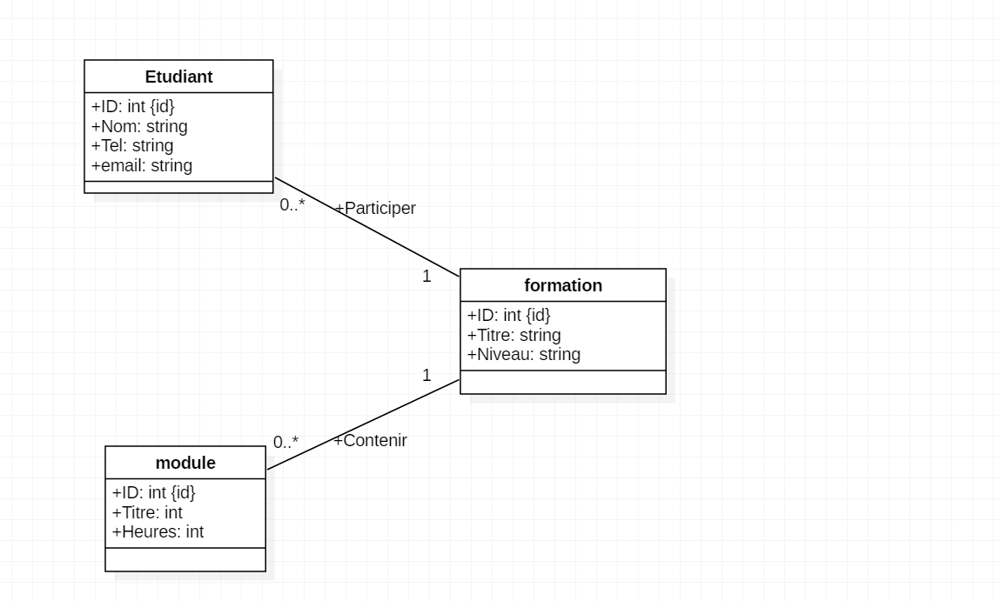

# TP 7 
Made by: Hiba Lamsselak
Instructor: Aymane Nefdaoui

## Features:

## Technologies:

## Analysis & Architecture:

### App Design

### Entities & Attributes:

| Entity    | Attributs          |
|-----------| -------------------|
|formations | id, titre, niveau  |
|-----------| -------------------|
|etudiants  | id, nom, tel, email|
|-----------| -------------------|
|modules    | id, titre, heures  |

### Diagramm UML:  

## Data Base:

## Structure: 

## CRUD:
### Formations:
### Etudiant:
### Module:

## Problems faced & Solutions:
